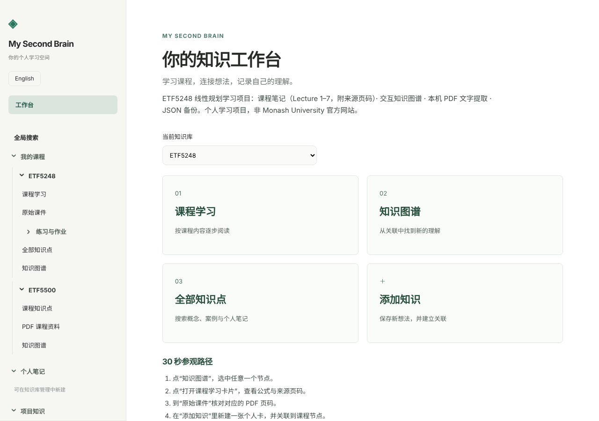
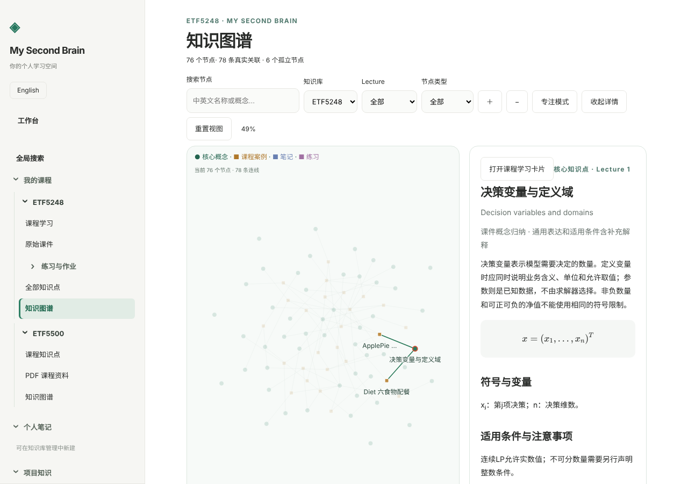
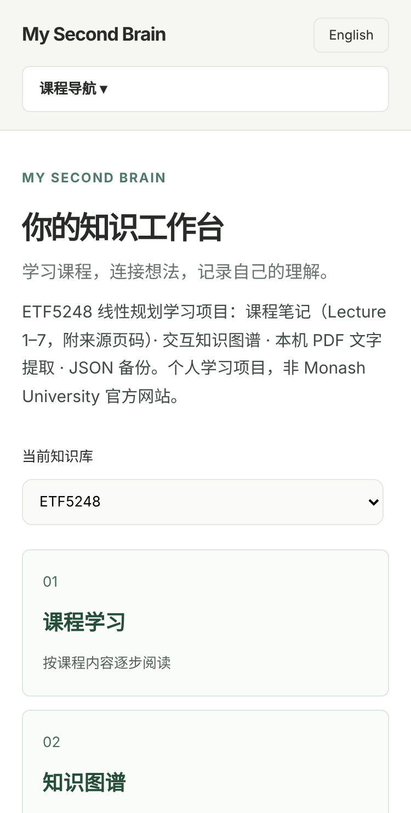

# My Second Brain V1.0

A bilingual, browser-local personal knowledge base. HTML, CSS and JavaScript; no build step or database required.

## What works
- Workspace, multiple knowledge bases, bilingual reading and search.
- ETF5248 Lectures 1–7: 50 concepts, 26 case studies, 22 practice sets and 104 original study records.
- ETX5500: a 79-card note pack (7 topics: intro, matrix basics, distance, clustering, MDS, PCA, factor models) paraphrased from lecture slides and tutorial solutions, with physical page numbers, bilingual LaTeX and 135 cross-links. It is loaded only by the "载入课程卡 / Load course cards" button inside the ETX5500 base; loading adds missing cards and never overwrites edits. Pack source: `course-data/etx5500-pack.js`. ETF5248 also has an optional 5-card supplement (`course-data/etf5248-pack.js`) for slide pages no built-in entry cites, loaded the same way inside the ETF5248 base. Earlier `ETF5500` libraries are renamed to `ETX5500` once (ids and notes kept, snapshot saved under `my-second-brain.backup.before-etx5500-rename`).
- Spaced review (`review.js`): each concept/practice card is shown title-first; answers are graded Forgot/Hard/Good (keys 1/2/3) and rescheduled; 15 new cards per day. Progress lives in its own key `my-second-brain.review.v1` and never touches note data. Built-in ETF5248 cases and practices without an answer are skipped.
- Automatic folder backup (`backup-folder.js`, Chrome/Edge): pick a folder once; notes and review progress are written there a few seconds after each change (`my-second-brain-backup.json`, a dated copy, `my-second-brain-review.json`). Nothing is uploaded or deleted. After a browser restart one click re-authorises the folder.
- Example bank (`examples.js`, data in `course-data/examples-data.js`): 114 worked examples (ETF5248 lectures 1–7, ETX5500 topics incl. tutorial questions), filterable by course/topic and searchable; problem first, solution on demand, with slide pages. Solutions follow the slides; where the slides leave an answer open, the solution says it was derived separately.
- My brain (`mybrain.js`): Ctrl+K palette that searches cards, examples, your notes and your own words and can capture a quick note; `[[title]]` links with a “Linked from” list on every card; a personal “My understanding” field on every card and example (also shown in review, own key `my-second-brain.mine.v1`, included in folder backup); links you write also become edges in the knowledge graph. Quick notes can start from templates (mistake review, job/interview review, use-it-in-practice, reading, daily three lines) and go to a personal “我的笔记” library created on first save; the home “Question of the day” opens the daily template.
- BEX5260 (Megatrends): a 133-card note pack (12 topics: overview, climate, carbon, sectors, digital disruption, digital assets, demographics, debt, sovereign debt) plus 35 official practice questions kept as examples (`course-data/bex5260-examples.js`) that the cards link to paraphrased from lecture slides with physical page numbers; loaded by an explicit button; read in “课程学习” (`course5260.js`, data `course-data/bex5260-pack.js`).
- ETX5500 course learning (`course5500.js`): the 79-card note pack read topic by topic with learned ticks (own key `my-second-brain.learned.v1`), a “My understanding” field per card and the topic’s examples; works before the pack is loaded into the knowledge base.
- Finance map (`course-data/finance-map.js`): 13 application notes linking course ideas (PCA, factor models, clustering, LP, sensitivity, integer programming…) to finance; written from general knowledge, not slide content, and not investment advice. Searchable with Ctrl+K, shown on the cards they build on, and reachable from the sidebar.
- Weekly review (`weekly.js`): last-7-day totals (cards reviewed, forgotten, new notes, “My understanding” edits, learned), 12-week activity map, streak, next steps. Review counts per day are logged in `my-second-brain.activity.v1` (included in folder backup). Mistakes list: the review dialog’s type filter “错题本” drills cards you have forgotten and not yet answered well 3 times since.
- Interactive graph: 76 original course nodes, 78 explicit relations; personal cards and user-confirmed links appear dynamically.
- Personal-card creation, editing, confirmed deletion, local persistence and JSON backup/restore.
- Text PDF extraction, physical-page tracking, manual drafts and review before saving.
- Local KaTeX formulas, source pages, graphical LP demonstration and quiz.
- Responsive layout and graph focus mode.

## 使用 / Usage
Open `index.html`, or visit the deployed site. Choose a base, then Course learning, Knowledge graph, All knowledge or Add knowledge.
在“全部知识点 → 管理与备份”中导出/导入 JSON。知识卡可选择内容类型并勾选同库关联。

## 30 秒参观路径 / 30-second tour
1. 打开首页 → 点「知识图谱」，选中任意节点（键盘：Tab 到节点，Enter 选中）。
2. 点「打开课程学习卡片」，查看公式、来源 PDF 页码。
3. 在「原始课件」中核对对应页码。
4. 在「添加知识」中新建一张个人卡，并关联到课程节点（数据只保存在你的浏览器里）。

Open the graph, select a node, open its course card, check the source slide, then add your own linked card.





## Data boundaries
Personal notes stay in each visitor’s browser, not on the website server. Clearing browser storage can erase notes. Different browsers and URLs have separate storage; export/import JSON to transfer notes. The website does not automatically share the owner's ApplePie or other private notes with visitors.
JSON includes personal cards, their types and relations. It does not include uploaded PDF binaries or the static course files. Uploaded files and unsaved PDF drafts last for the current session only.
No accounts, cloud synchronization or AI Tutor are implemented. Mock AI is explicitly simulated and requires the separate local development server. This static deployment does not provide a Gemini backend, API key or public AI endpoint. Manual PDF extraction remains usable without AI.

## Course attribution
Course material is based on ETF5248 lecture slides. This is a personal study project, not an official Monash University site. Slide paraphrases, supplementary explanations and authored exercises are labeled; citations use physical PDF pages. Existing source ambiguities remain flagged. A working citation link is not proof of academic correctness.

## Free static deployment / GitHub Pages
Publish this folder’s **contents** to a public repository: `index.html` at the repository root. Preserve `vendor`, `course-data`, `course-materials` and `.nojekyll`.
In repository Settings → Pages, select Deploy from a branch, the uploaded branch and `/ (root)`; use the URL GitHub returns after deployment succeeds.
Upload the extracted files, not the ZIP itself. Do not upload the parent development folder: it contains local configuration and private test/backup artifacts that are not part of this release.
No package installation, build command, paid API or custom domain is required. GitHub Free supports Pages from public repositories; see https://docs.github.com/en/pages/getting-started-with-github-pages/what-is-github-pages .

## 备份格式 / Backup format
JSON 备份包含 `format`、`version: 2`、`libraries`、`items`，以及导出时间 `exportedAt`、`app`、`appVersion`（附加元数据，导入时被忽略，旧备份仍可导入）。首页会显示“上次导出”日期；有笔记且超过 14 天未导出时提醒。

## 冒烟测试 / Smoke test
推送前运行，约 20 秒：每个侧边栏入口都能打开、首页入口可跳转、图谱节点可用键盘选中且焦点不丢、公开站点不显示 Mock/Gemini 面板、手机无横向滚动。

```bash
npm i -D playwright && npx playwright install chromium
python -m http.server 8000        # 在网站目录中另开一个终端
node tests/smoke.mjs http://localhost:8000/index.html
```

## Validation
The interface regression suites passed 13 grouped browser checks before packaging; `tests/smoke.mjs` adds a repeatable smoke test (navigation, graph keyboard focus, public-site AI panel hidden, mobile layout). The release preparation additionally compares every shipped asset byte-for-byte with the tested site. Live deployment is not confirmed until an actual deployment URL is returned and tested.

## Local development project
The original checkout keeps the local launchers and server separately; these are deliberately excluded from this static release. Do not put secrets, personal JSON backups, or Codex-Memory into this folder.
